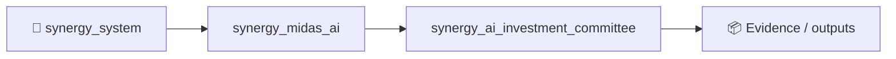
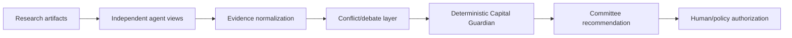

# SYNERGY AI Investment Committee

> **Auditable multi-agent investment decision support with deterministic Capital Guardian boundary**

Version: `2.0.0`

**Enterprise v2.0.0** · FastAPI/OpenAPI · Docker/Compose · RBAC/JWT · PostgreSQL/ClickHouse audit

**Designed for:** Quant funds, asset managers, research teams and AI-native investment desks  
**Primary endpoint:** `POST /enterprise/v1/committee/deliberate`

> [!IMPORTANT]
> Decision-support infrastructure only. AI deliberation is not autonomous execution authority; deterministic risk/Capital Guardian controls remain separate.

## Verification
**20 tests passed** · health smoke **80/80 200** · local p95 **79.3 ms** (~549 req/s). Health smoke only.

## Quick start
```bash
pip install -e '.[dev,enterprise]'
pytest -q
python -m synergy_ai_committee.api
```

## CTO package
[Due diligence](docs/CTO_DUE_DILIGENCE.md) · [Architecture](docs/ARCHITECTURE_DIAGRAMS.md) · [API](docs/API_EXAMPLES.md) · [Security](SECURITY.md) · [Benchmarks](docs/BENCHMARKS_AND_ACCEPTANCE.md) · [SLA/SLO](docs/SLA_SLO.md) · [Deployment](docs/DEPLOYMENT_CHECKLIST.md) · [Pilot](docs/CUSTOMER_PILOT.md)


<!-- SYNERGY-FEDERATION-PASSPORT:START -->
---

## 🧭 SYNERGY federation passport

**Домен:** 🏛️ AI investment committee  
**Архитектурный родитель:** [`synergy_midas_ai`](https://github.com/Shtenco/synergy_midas_ai)  
**Архитектурный корень:** [`synergy_system`](https://github.com/Shtenco/synergy_system)



Архитектурная стрелка — это карта федерации, а не автоматически подтверждённая runtime dependency.

### Единый стандарт

Каждый проект должен документировать реальную проблему, реализацию, тесты, evidence, ограничения, file map, воспроизводимость, roadmap и границы утверждений. Это тот же принцип, который используется в `dlp_solver`.

### Навигация

- [📚 Атлас всех 75 репозиториев](https://github.com/Shtenco/synergy_system/blob/main/docs/SYNERGY_REPOSITORY_ATLAS.md)
- [🧾 Машиночитаемый registry](https://github.com/Shtenco/synergy_system/blob/main/registry/SYNERGY_REPOSITORIES.json)
- [🧭 SYNERGY SYSTEM](https://github.com/Shtenco/synergy_system)

### Evidence rule

`GREEN` означает только воспроизводимо подтверждённый тезис. Гипотеза, benchmark без корректного протокола, архитектурная диаграмма или красивый экономический цикл сами по себе GREEN не дают.

<!-- SYNERGY-FEDERATION-PASSPORT:END -->
---

# 🏛️ Глубокая техническая спецификация AI Investment Committee

## 🎯 Проблема

Несколько AI-агентов могут создавать видимость консенсуса, не добавляя независимой информации. Комитет нужен как audit-friendly decision-support, а не как автономный распорядитель капитала.

## 🏗️ Pipeline



## 📥 Входы

- research reports;
- model outputs;
- risk reports;
- portfolio constraints;
- provenance/evidence;

## 📤 Выходы

- structured recommendation;
- dissent/conflict record;
- confidence with evidence refs;
- required conditions;
- NO_ACTION;

## 🛡️ Непереговорные инварианты

```text
agent vote count != evidence strength
committee cannot bypass Capital Guardian
missing evidence must remain UNKNOWN
human/policy authorization separate from deliberation
all recommendations bind source artifacts
```

## 🧪 Как ловить ложный GREEN

- отделять API/health benchmark от качества торгового решения;
- проверять stale-state и timestamp binding;
- иметь negative/adversarial tests;
- не считать unit-test coverage доказательством инвестиционной ценности;
- сохранять request → decision → downstream evidence chain;
- явно указывать, что измерено локально, а что требует customer/live validation.

## 🔗 Контракт с соседями

- [`synergy_agi_nexus`](https://github.com/Shtenco/synergy_agi_nexus)
- [`synergy_midas_ai`](https://github.com/Shtenco/synergy_midas_ai)
- [`synergy_riskguard`](https://github.com/Shtenco/synergy_riskguard)
- [`synergy_financial_os`](https://github.com/Shtenco/synergy_financial_os)

## 🚀 Следующий доказательный рубеж

1. frozen acceptance dataset;
2. adversarial fixtures;
3. cross-module typed contract;
4. end-to-end trace id;
5. OOS/shadow evidence where market quality is claimed;
6. explicit failure-mode table;
7. reproducible evidence bundle referenced from README.
