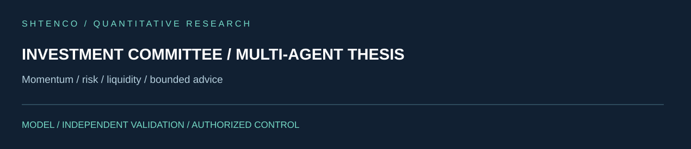

<!-- SCIENTIFIC-V4-2026:START -->


[Научно-техническое досье V4](docs/SCIENTIFIC_DOSSIER_V4_2026.md) — математическая модель, архитектура, эксперименты. Исходный README ниже сохранён полностью.
<!-- SCIENTIFIC-V4-2026:END -->

#  SYNERGY AI Investment Committee — verified technical dossier

> **Статус:**  CANDIDATE — core deliberation, typed federation contract, FastAPI enterprise surface and tests are present in `main`; production deployment is not inferred from source presence.
> **Проверено по фактическому tree/source/tests:** 29.09.2026.

## 1.  Задача

Этот repository реализует bounded investment-committee layer: несколько простых экспертных ролей формируют investment thesis, при этом output остаётся **advisory evidence**, а не автоматическим разрешением на сделку.

Главная архитектурная граница:

```text
committee thesis != order authorization
model/agent vote  != capital authority
API response      != executed trade
```

## 2.  Фактический состав

В `main` присутствуют:

- `src/synergy_ai_committee/` — Python package;
- `core.py` — committee deliberation;
- `api.py` — API surface;
- `synergy_contracts.py` — federation payload;
- `enterprise/` — auth/audit/control layer;
- `tests/` — core, product, service, adapters, deployment, release metadata, contracts;
- `Dockerfile`, `Makefile`, `pyproject.toml`;
- `deploy/`, `loadtests/`, `demo/`, `examples/`, `docs/`;
- security/changelog/env example files.

Это уже не documentation shell.

## 3.  Core model

`core.py` определяет:

### `MarketContext`

Поля:

```text
symbol
momentum
volatility
valuation
liquidity
```

### Agent roles

Реализованы:

- `MomentumAgent`;
- `RiskAgent`;
- `LiquidityAgent`.

Каждый возвращает `Vote(role, score, reason)`.

### `deliberate(...)`

Алгоритм:

1. собирает votes;
2. усредняет score;
3. применяет hard volatility veto;
4. при veto возвращает `NO_TRADE`;
5. иначе:
   - score > 0.2 → BUY;
   - score < -0.2 → SELL;
   - иначе NO_TRADE.

Если:

[
volatility ge risk_veto_vol
]

то:

```text
capital_guardian = VETO_VOLATILITY
action = NO_TRADE
```

## 4.  Архитектура

```mermaid
flowchart LR
    OBS[Market observation] --> CTX[MarketContext]
    CTX --> M[Momentum Agent]
    CTX --> R[Risk Agent]
    CTX --> L[Liquidity Agent]
    M --> V[Votes]
    R --> V
    L --> V
    V --> D[deliberate()]
    D --> T[Investment Thesis]
    T --> MIDAS[synergy_midas_ai]
    T -. advisory only .-> EXEC[Execution authority]
```

## 5.  Federation contract

`synergy_contracts.py` объявляет:

```text
CONTRACT_ID = synergy.trading.investment-thesis/v1
AUTHORITY   = investment_committee
```

Payload builder `investment_thesis_payload(...)`:

- требует непустой `observation_id`;
- нормализует symbol;
- выполняет `deliberate()`;
- добавляет:
  - `authorization = False`;
  - `requires_domain_validation = True`.

Это важная fail-safe граница.

## 6.  Inputs

Фактический typed input:

- observation id;
- symbol;
- momentum;
- volatility;
- valuation;
- liquidity;
- risk-veto threshold.

## 7.  Outputs

Thesis содержит:

- symbol;
- aggregate score;
- action;
- votes;
- capital guardian state;
- observation id;
- explicit `authorization=false`;
- domain-validation requirement.

## 8.  Authority / invariants

```text
investment thesis != broker order
BUY/SELL label     != permission to trade
risk veto          must dominate score aggregation
viewer role        != committee execution role
audit log          != market truth
```

Downstream system обязан отдельно проверять portfolio, risk, execution and policy constraints.

## 9.  Реальные tests

В `tests/` присутствуют отдельные suites для:

- core;
- customer demo;
- enterprise adapters;
- enterprise deployment;
- enterprise foundation;
- enterprise product;
- enterprise service;
- release metadata;
- SYNERGY contracts.

`test_enterprise_product.py` подтверждает на уровне source:

- POST `/enterprise/v1/committee/deliberate`;
- authorized role `risk` получает 200;
- response содержит `action`, `capital_guardian`, `request_id`;
- request id появляется в enterprise audit endpoint;
- role `viewer` получает 403;
- API экспонирует enterprise health/control routes.

README не подменяет наличие tests observed-green run.

## 10.  Enterprise boundary

Тесты используют signed role tokens и tenant/request identity. Это показывает наличие:

- role-aware endpoint protection;
- audit linkage;
- request correlation.

Следующие обязательные проверки production уровня:

- production secret rotation;
- token issuer/audience;
- clock skew/expiry;
- multi-tenant isolation;
- audit persistence;
- tamper evidence;
- rate limiting.

## 11.  Failure modes

| Failure | Gate |
|---|---|
| volatility shock | NO_TRADE veto |
| viewer calls committee endpoint | 403 |
| missing observation id | reject in federation payload |
| committee output used as trade authorization | запрещено architecture contract |
| stale market observation | downstream/domain validation required |
| manipulated momentum/liquidity | input provenance still required |
| audit storage loss | production evidence gap |

## 12.  Воспроизводимость

Ожидаемый local path:

```bash
git clone https://github.com/Shtenco/synergy_ai_investment_committee.git
cd synergy_ai_investment_committee
python -m pip install -e .
pytest -q
```

Container/deploy manifests также присутствуют, но production deployment не объявляется без observed evidence.

## 13.  Карта repository

| Path | Role |
|---|---|
| `src/.../core.py` | committee voting/veto logic |
| `src/.../synergy_contracts.py` | investment-thesis federation payload |
| `src/.../api.py` | API |
| `src/.../enterprise/` | auth/audit/control plane |
| `tests/` | product/service/deployment/contract tests |
| `Dockerfile` | container build |
| `deploy/` | deployment assets |
| `loadtests/` | load-test assets |
| `SECURITY.md` | security notes |

## 14.  Место в SYNERGY

```text
market observations / specialist signals
→ Investment Committee
→ investment-thesis/v1
→ MIDAS
→ deterministic risk/execution validation
```

Основной consumer: [`synergy_midas_ai`](https://github.com/Shtenco/synergy_midas_ai).

## 15.  Evidence maturity

| Layer | Status |
|---|---|
| core deliberation code |  |
| volatility veto |  |
| federation payload |  |
| enterprise API source |  |
| auth/audit tests |  source |
| Docker/deploy scaffold |  |
| observed cross-repo E2E |  not promoted |
| live trading authorization | intentionally  |
| production deployment | not inferred |

## 16.  Roadmap

1. bind observation provenance/hash;
2. calibrate scores on strict OOS;
3. add confidence/uncertainty;
4. test adversarial/noisy observations;
5. persist tamper-evident audit;
6. connect to portfolio/risk authority without granting committee execution power;
7. produce observed M4/M5 federation evidence.

## 17.  Что проект НЕ утверждает

- что три heuristic agents дают alpha;
- что BUY/SELL является приказом брокеру;
- что source tests уже прошли в production CI;
- что API production-secure только потому, что есть auth code;
- что committee может обходить MIDAS/risk authority.

---

[ SYNERGY SYSTEM](https://github.com/Shtenco/synergy_system) · [ Atlas](https://github.com/Shtenco/synergy_system/blob/main/docs/SYNERGY_REPOSITORY_ATLAS.md)
