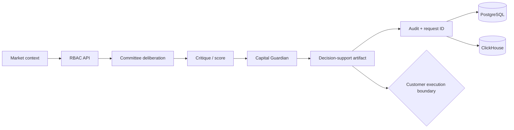

# Architecture — SYNERGY AI Investment Committee

Primary endpoint: `/enterprise/v1/committee/deliberate`. Committee output is advisory/decision-support evidence, not autonomous authority to place live orders.